# Product Requirements Document (PRD)
## JGEC Internship Management Portal

**Version:** 1.0.1  
**Date:** 2026-11-05  
**Author:** Subhas Mondal  
**Status:** Draft

---

## Table of Contents

1. [Executive Summary](#1-executive-summary)
2. [Goals, Non-Goals and Success Metrics](#2-goals-non-goals-and-success-metrics)
3. [User Roles and Personas](#3-user-roles-and-personas)
4. [User Journeys and Workflows](#4-user-journeys-and-workflows)
5. [Feature Specification](#5-feature-specification)
6. [Functional and Non-Functional Requirements](#6-functional-and-non-functional-requirements)
7. [System Architecture](#7-system-architecture)
8. [Data Model](#8-data-model)
9. [API Documentation](#9-api-documentation)
10. [Authentication and Authorization](#10-authentication-and-authorization)
11. [Third-Party Integrations](#11-third-party-integrations)
12. [Notifications System](#12-notifications-system)
13. [NOC Generation](#13-noc-generation)
14. [Security and Compliance](#14-security-and-compliance)
15. [Testing Strategy](#15-testing-strategy)
16. [DevOps and Setup](#16-devops-and-setup)
17. [Analytics and Reporting](#17-analytics-and-reporting)
18. [Risks, Limitations and Technical Debt](#18-risks-limitations-and-technical-debt)
19. [Roadmap](#19-roadmap)
20. [Glossary and Appendices](#20-glossary-and-appendices)

---

## 1. Executive Summary

### Problem Statement
Jalpaiguri Government Engineering College (JGEC) currently manages internship applications and NOC (No Objection Certificate) generation through fragmented processes. This results in:
- Paper-based application submissions that are difficult to track
- Delayed approval workflows with no visibility into status
- Manual NOC generation and document verification
- Lack of centralized communication between students, TPOs (Training and Placement Officers), SPOCs (Single Points of Contact), and administrators

### Solution
A centralized web-based platform to manage the complete internship lifecycle at JGEC, enabling:
- Online application submission and tracking
- Multi-level approval workflow (Student → TPO → SPOC → NOC Generation)
- Electronic NOC generation with Google Drive storage
- Real-time notifications and email communications

### Target Institution
**Jalpaiguri Government Engineering College (JGEC)**  
Department: Training and Placement Cell

### Value Proposition
| Stakeholder | Benefit |
|-------------|---------|
| Students | Easy online application submission, real-time status tracking, digital NOC delivery |
| TPOs | Department-specific application review, bulk actions, export capabilities |
| SPOCs | Organized application review by organisation, bulk NOC generation |
| Administrators | Centralized oversight, company management, student analytics |

---

## 2. Goals, Non-Goals and Success Metrics

### Goals
| Goal | Metric | Target |
|------|--------|--------|
| Reduce application processing time | Approval turnaround time | < 48 hours for each stage |
| Improve NOC generation efficiency | NOC generation time | < 15 minutes per batch |
| Increase digital adoption | Platform adoption rate | 90% of students |
| Reduce paperwork | Paper form reduction | 100% digital workflow |

### Non-Goals (Out of Scope)
- Direct placement coordination or interview scheduling
- Student placement offer management
- Payment/fee collection system
- Mobile native applications (responsive web only)
- SMS-based notifications (email only)

### Success Metrics (KPIs)
1. **Approval Turnaround Time**: Average hours from submission to first decision
2. **NOC Generation Time**: Average time to generate and deliver NOC after approval
3. **Application Completion Rate**: % of started applications that are submitted
4. **Platform Adoption**: % of active students using the portal
5. **Notification Delivery Rate**: % of notifications successfully delivered via email
6. **System Uptime**: Target 99.5% availability during academic months

---

## 3. User Roles and Personas

### User Roles Overview

| Role | Model | Description | Primary Concerns |
|------|-------|-------------|------------------|
| **Student** | `Student` | Enrolled student seeking internship | Application tracking, NOC access, document management |
| **TPO** | `TPO` | Department Training and Placement Officer | Student applications from their department, approvals |
| **SPOC** | `SPOC` | Single Point of Contact (Organisation Liaison) | Application review by organisation, NOC generation |
| **Admin** | `Admin` | System administrator | Company management, student oversight, system config |

### Role Permissions Matrix

| Feature | Student | TPO | SPOC | Admin |
|---------|---------|-----|------|-------|
| **Login/Logout** | ✓ | ✓ | ✓ | ✓ |
| **View Dashboard** | ✓ | ✓ | ✓ | ✓ |
| **Submit Application** | ✓ | ✗ | ✗ | ✗ |
| **Edit Draft Application** | ✓ | ✗ | ✗ | ✗ |
| **View Own Applications** | ✓ | ✓ (dept) | ✓ | ✓ |
| **Review Applications** | ✗ | ✓ | ✓ | ✗ |
| **Approve Applications** | ✗ | ✓ | ✓ | ✗ |
| **Reject Applications** | ✗ | ✓ | ✓ | ✗ |
| **Request Updates** | ✗ | ✓ | ✓ | ✗ |
| **Generate NOC** | ✗ | ✗ | ✓ | ✗ |
| **Bulk NOC Generation** | ✗ | ✗ | ✓ | ✗ |
| **Manage Organisations** | ✗ | ✗ | ✗ | ✓ |
| **View Analytics** | ✗ | ✓ (dept) | ✓ (org) | ✓ |
| **Export Reports** | ✗ | ✓ | ✓ | ✓ |

### Persona Profiles

#### Student Persona
> **Name:** Priya (fictional)  
> **Year:** 4th Year CSE  
> **Goals:** Find internship, get NOC, track application status  
> **Pain Points:** "I don't know where my application is", "How long will NOC take?", "I forgot what documents I uploaded"

#### TPO Persona
> **Name:** Dr. Sen (fictional)  
> **Department:** CSE  
> **Goals:** Review department students' applications, ensure quality  
> **Pain Points:** "Searching for students across all orgs", "No department filter", "Manual tracking in spreadsheets"

#### SPOC Persona
> **Name:** Mr. Das (fictional)  
> **Organisation:** XYZ Technologies  
> **Goals:** Approve relevant applications, generate NOCs  
> **Pain Points:** "Applications scattered across departments", "Generating individual NOCs is tedious", "No bulk processing"

#### Admin Persona
> **Name:** Placement Cell Head (fictional)  
> **Goals:** Oversee all operations, manage organisations  
> **Pain Points:** "No overview of all applications", "Can't see company analytics", "Manual report generation"

---

## 4. User Journeys and Workflows

### Application Lifecycle Flow

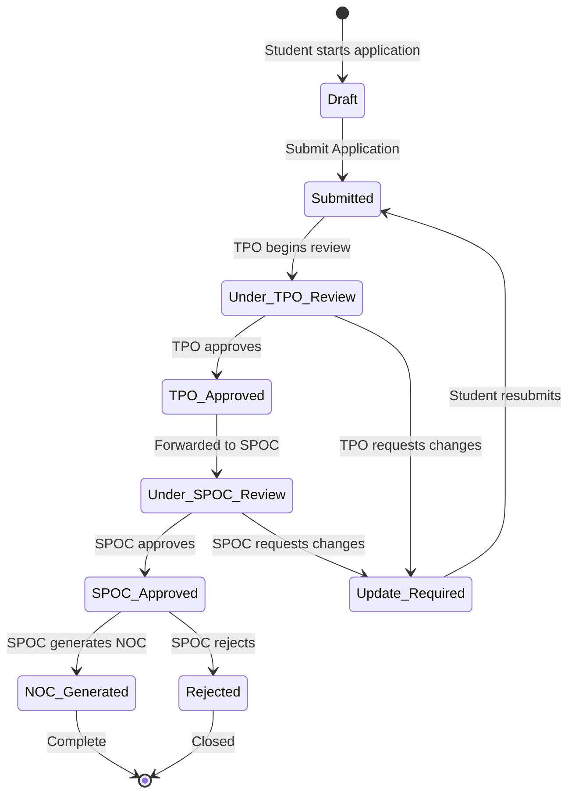

### User Journeys

#### Journey 1: Student Signup and Login
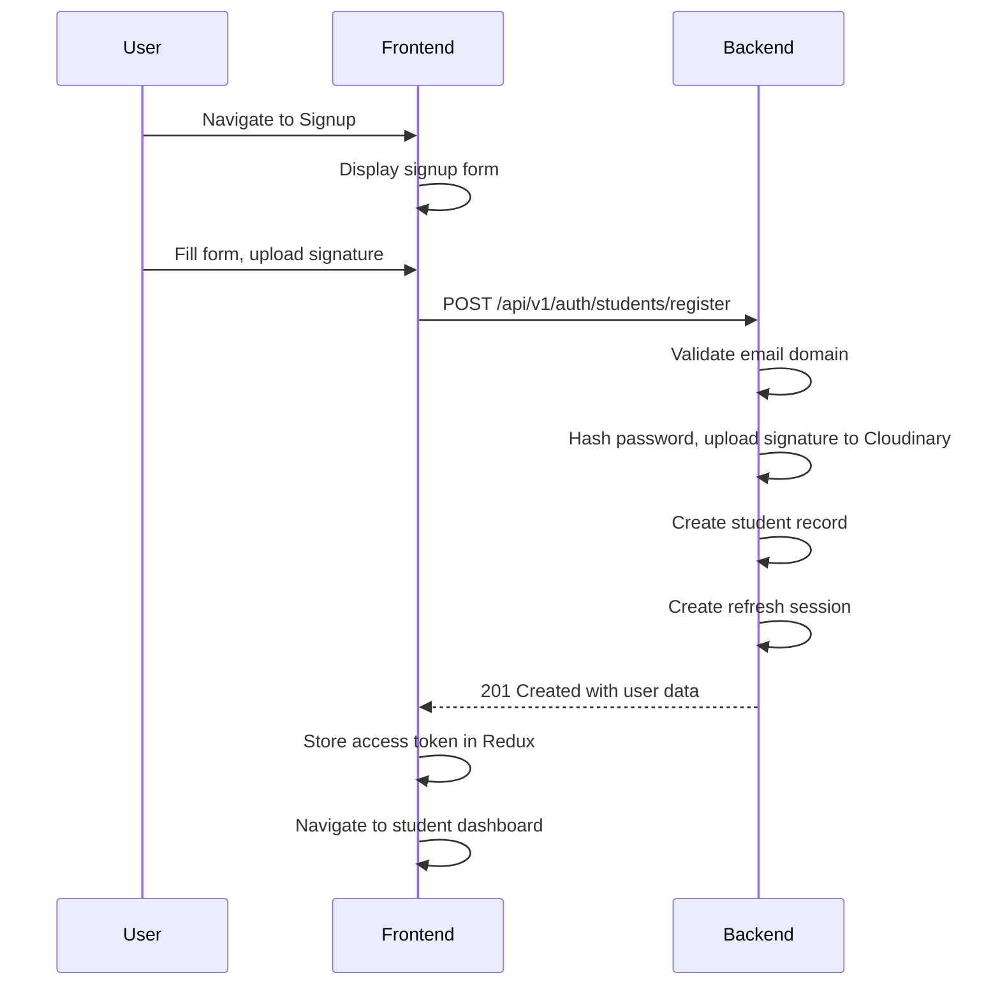

#### Journey 2: Application Submission
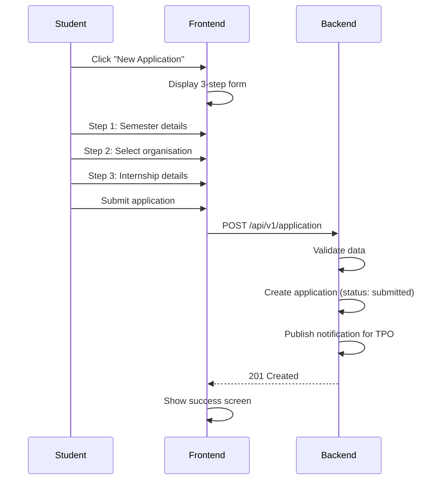

#### Journey 3: TPO Review Workflow
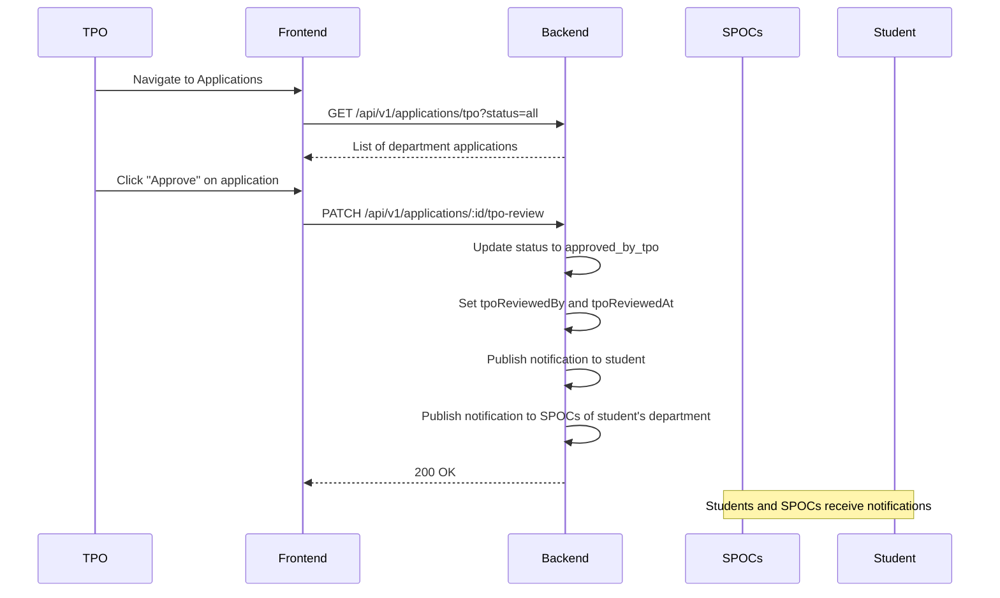

#### Journey 4: SPOC Application Review
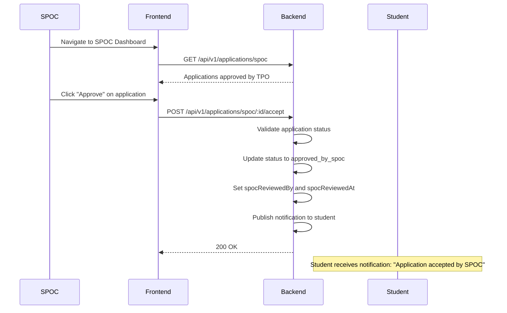

#### Journey 5: NOC Generation (Single)
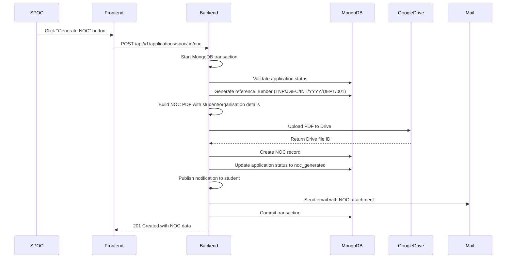

#### Journey 6: Bulk NOC Generation
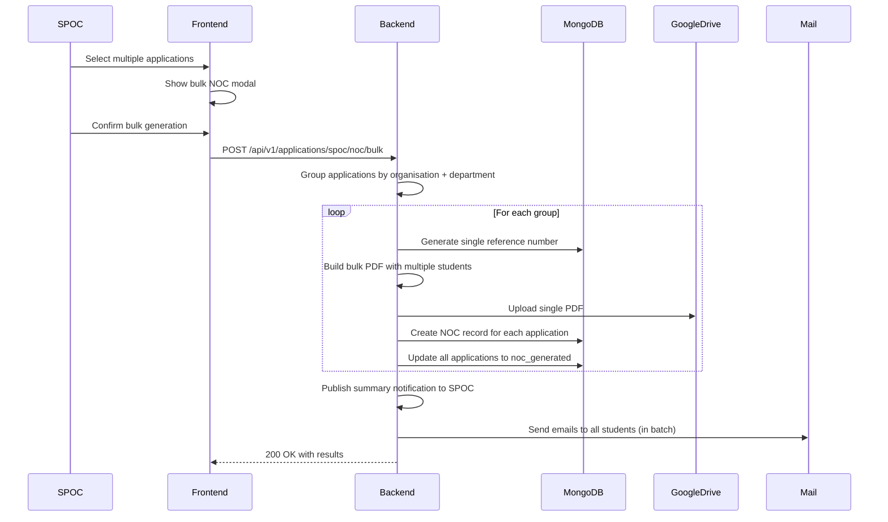

### Application Status Flow

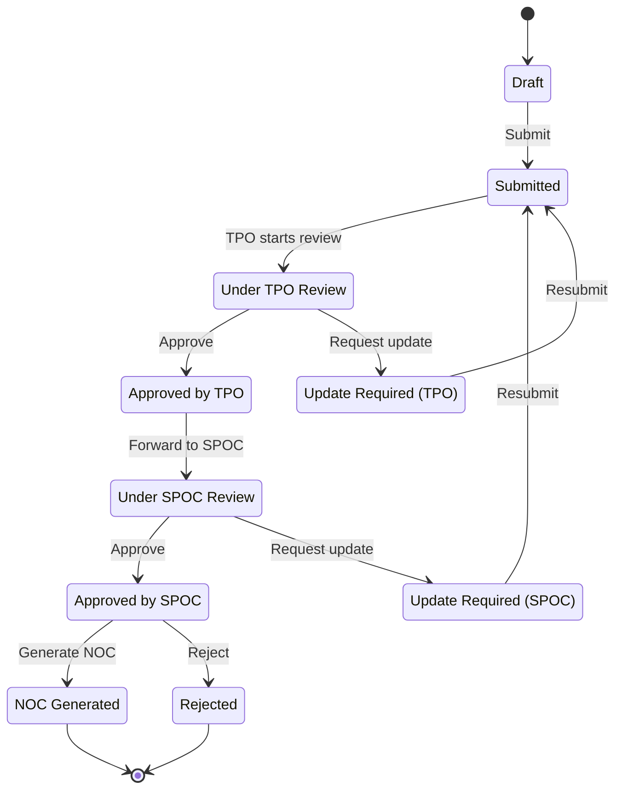

---

## 5. Feature Specification

### Module: Authentication & Authorization

| Feature | Description | User Stories | API Endpoints |
|---------|-------------|--------------|---------------|
| **Student Login** | Students can log in with email and password | As a student, I want to log in to access my applications | `POST /api/v1/auth/students/login` |
| **TPO Login** | TPOs can log in with email and password | As a TPO, I want to log in to review applications | `POST /api/v1/auth/tpo/login` |
| **SPOC Login** | SPOCs can log in with email and password | As an SPOC, I want to log in to review applications | `POST /api/v1/auth/spoc/login` |
| **Student Register** | Students can register with college email | As a student, I want to register using my college email | `POST /api/v1/auth/students/register` |
| **TPO Register** | TPOs can register with valid TPO ID | As a TPO, I want to register with my TPO ID | `POST /api/v1/auth/tpo/register` |
| **SPOC Register** | SPOCs can register with college email | As an SPOC, I want to register using my college email | `POST /api/v1/auth/spoc/register` |
| **Refresh Token** | Automatic token refresh on expiry | As a user, I want to stay logged in without re-authenticating | `POST /api/v1/auth/refresh-token` |
| **Logout** | Users can log out and invalidate sessions | As a user, I want to securely log out | `POST /api/v1/auth/logout` |
| **Get Current User** | Retrieve authenticated user details | As a user, I want my profile data on page load | `GET /api/v1/auth/me` |

### Module: Student Dashboard

| Feature | Description | User Stories | API Endpoints |
|---------|-------------|--------------|---------------|
| **Student Dashboard** | Overview of applications, notifications, stats | As a student, I want to see my application status | `GET /api/v1/dashboard` |
| **New Application** | Multi-step form to submit application | As a student, I want to apply for internships | `POST /api/v1/application` |
| **View Applications** | List of all submitted applications | As a student, I want to see my application history | `GET /api/v1/application` |
| **Edit Application** | Update draft applications | As a student, I want to edit my draft | `PATCH /api/v1/application/:id/resubmit` |
| **Student Documents** | Manage signature and resume uploads | As a student, I want to upload documents | `POST /api/v1/student/documents` |
| **Student Notifications** | View notification history | As a student, I want to see updates about my applications | `GET /api/v1/student/notifications` |
| **Mark Notification Read** | Mark notifications as read | As a student, I want to track unread notifications | `PUT /api/v1/student/notifications/:id/read` |

### Module: TPO Dashboard

| Feature | Description | User Stories | API Endpoints |
|---------|-------------|--------------|---------------|
| **TPO Dashboard** | Department overview and quick actions | As a TPO, I want to see department statistics | `GET /api/v1/tpo/dashboard` |
| **All Applications** | Filterable list of department applications | As a TPO, I want to review all department applications | `GET /api/v1/applications/tpo` |
| **Pending Applications** | Filter: applications awaiting review | As a TPO, I want to see pending applications | `GET /api/v1/applications/tpo?status=pending` |
| **Approved Applications** | Filter: applications approved by TPO | As a TPO, I want to see approved applications | `GET /api/v1/applications/tpo?status=approved_by_tpo` |
| **Rejected Applications** | Filter: rejected applications | As a TPO, I want to see rejected applications | `GET /api/v1/applications/tpo?status=rejected` |
| **Send to SPOC** | Forward approved applications to SPOC | As a TPO, I want to forward applications to SPOC | `PATCH /api/v1/applications/:id/tpo-review (approve)` |
| **Reject Application** | Reject application with reason | As a TPO, I want to reject an application | `PATCH /api/v1/applications/:id/tpo-review (reject)` |
| **Request Update** | Ask student for changes | As a TPO, I want to request changes to an application | `PATCH /api/v1/applications/:id/tpo-review (send_back)` |
| **TPO Analytics** | Charts and statistics for department | As a TPO, I want to see department analytics | `GET /api/v1/tpo/dashboard/stats` |
| **Export TPO Data** | Download application report | As a TPO, I want to export department data | `GET /api/v1/tpo/dashboard/export` |

### Module: SPOC Dashboard

| Feature | Description | User Stories | API Endpoints |
|---------|-------------|--------------|---------------|
| **SPOC Dashboard** | Overview of applications by organisation | As an SPOC, I want to see organisation applications | `GET /api/v1/applications/spoc` |
| **Organisation Grouping** | Group applications by organisation | As an SPOC, I want applications grouped by company | `GET /api/v1/applications/spoc/organisation/:id` |
| **Accept Application** | Approve application | As an SPOC, I want to approve applications | `POST /api/v1/applications/spoc/:id/accept` |
| **Reject Application** | Reject application with reason | As an SPOC, I want to reject applications | `POST /api/v1/applications/spoc/:id/reject` |
| **Send Back** | Request changes from student | As an SPOC, I want to send application back for updates | `POST /api/v1/applications/spoc/:id/send-back` |
| **Generate Single NOC** | Create NOC for single application | As an SPOC, I want to generate NOC for approved student | `POST /api/v1/applications/spoc/:id/noc` |
| **Generate Bulk NOC** | Create multiple NOCs at once | As an SPOC, I want to generate NOCs in bulk | `POST /api/v1/applications/spoc/noc/bulk` |
| **NOC List** | View all generated NOCs | As an SPOC, I want to see my NOC history | `GET /api/v1/applications/spoc/nocs` |
| **Download NOC PDF** | Download generated NOC | As an SPOC, I want to download NOC PDF | `GET /api/v1/applications/spoc/:id/noc/pdf` |
| **Regenerate NOC** | Re-generate NOC for revision | As an SPOC, I want to regenerate NOC if needed | `POST /api/v1/applications/spoc/:id/noc/regenerate` |

### Module: Admin Dashboard

| Feature | Description | User Stories | API Endpoints |
|---------|-------------|--------------|---------------|
| **Admin Dashboard** | System-wide overview | As an admin, I want to see overall statistics | `GET /api/v1/admin/dashboard` |
| **Organisation Management** | CRUD for organisations | As an admin, I want to manage organisations | `GET/POST /api/v1/organisation` |
| **Student Management** | View all students | As an admin, I want to view all students | `GET /api/v1/admin/students` |
| **System Status** | Server health monitoring | As an admin, I want to monitor system health | `GET /api/v1/health` |

### Module: Landing Page & Public

| Feature | Description | User Stories | API Endpoints |
|---------|-------------|--------------|---------------|
| **Landing Page** | Public overview of platform | As a visitor, I want to learn about the platform | `GET /` |
| **Contact Page** | Contact information | As a visitor, I want contact information | `/contact` (frontend route) |
| **FAQ Section** | Frequently asked questions | As a visitor, I want to see FAQs | `/faq` (frontend route) |

---

## 6. Functional and Non-Functional Requirements

### Functional Requirements

| ID | Requirement | Description |
|----|-------------|-------------|
| FR-001 | Role-based Authentication | System shall support login for Students, TPOs, SPOCs, and Admins with separate authentication flows |
| FR-002 | Access Token Management | System shall issue JWT access tokens with configurable expiry and support refresh token rotation |
| FR-003 | Email Domain Validation | System shall restrict registration to college-approved email domains |
| FR-004 | Application Status Tracking | System shall track application status through: Draft, Submitted, Under TPO Review, Update Required, Approved by TPO, Under SPOC Review, Approved by SPOC, Rejected, NOC Generated |
| FR-005 | Multi-Stage Review Workflow | System shall enforce workflow: Student submits → TPO reviews → SPOC reviews → NOC generation |
| FR-006 | Department-based Filtering | TPOs shall only see applications from their assigned department |
| FR-007 | Organisation-based Filtering | SPOCs shall see applications filtered by their assigned organisation |
| FR-008 | NOC Reference Number Generation | System shall generate sequential NOC reference numbers in format: TNP/JGEC/INT/YYYY/DEPT/NNN |
| FR-009 | PDF Generation | System shall generate NOC PDFs with student, organisation, and signatory details |
| FR-010 | Google Drive Storage | System shall store NOC PDFs in Google Drive and reference by file ID |
| FR-011 | Bulk NOC Generation | System shall support generating multiple NOCs in a single request, grouped by organisation + department |
| FR-012 | Email Notifications | System shall send email notifications for status changes with NOC attached upon generation |
| FR-013 | In-App Notifications | System shall store notifications in database with read/unread status |
| FR-014 | Application Export | System shall support CSV/Excel export of applications |
| FR-015 | File Upload | System shall support signature and document uploads with Cloudinary integration |
| FR-016 | Organisation Management | System shall support CRUD operations for organisations |
| FR-017 | Health Check | System shall expose `/api/v1/health` endpoint for monitoring |
| FR-018 | Session Management | System shall support refresh session creation, validation, and revocation |

### Non-Functional Requirements

| ID | Requirement | Description | Target |
|----|-------------|-------------|--------|
| NFR-001 | Security | All API endpoints shall validate input and enforce authorization | JWT tokens, role middleware |
| NFR-002 | Performance | Dashboard pages shall load in < 2 seconds | 95th percentile |
| NFR-003 | Availability | System shall be available 99.5% of the time during academic months | Annual uptime |
| NFR-004 | Scalability | System shall support 500+ concurrent users during peak periods | Concurrent users |
| NFR-005 | Accessibility | UI shall meet WCAG 2.1 AA standards | Semantic HTML, ARIA labels |
| NFR-006 | Responsiveness | UI shall be fully responsive on mobile, tablet, and desktop | 320px - 2560px width |
| NFR-007 | Reliability | NOC generation shall use MongoDB transactions to ensure data consistency | ACID compliance |
| NFR-008 | Auditability | All application state changes shall be logged with timestamp and user | Audit trail |
| NFR-009 | Data Persistence | All user data, applications, and NOCs shall be persisted in MongoDB | Data retention |
| NFR-010 | Error Handling | System shall return consistent error responses with descriptive messages | HTTP status codes |

---

## 7. System Architecture

### High-Level Component Diagram

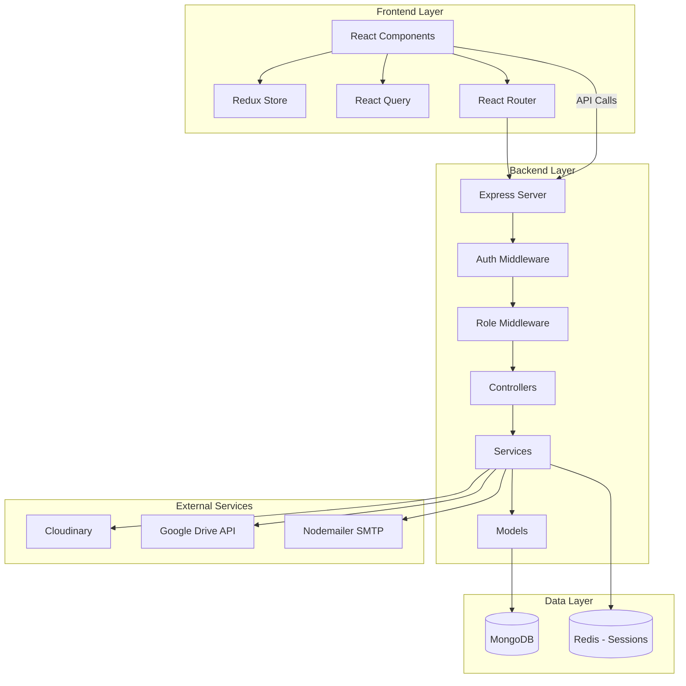

### Frontend Architecture

| Layer | Description |
|-------|-------------|
| **Components** | Reusable UI components (Button, Card, Input, Modal, Select, Toast, etc.) |
| **Pages** | Route-specific pages (Dashboard, Applications, Profile, etc.) |
| **Layouts** | Role-based layouts (StudentLayout, SPOCLayout, TPOLayout, AdminLayout) |
| **Services** | API service layer with axios interceptors for auth |
| **Queries** | React Query hooks for data fetching and mutations |
| **Store** | Redux store with authSlice for authentication state |
| **Hooks** | Custom hooks (useLogin, useSignup, useTPOAuth) |
| **Routes** | React Router configuration with protected routes |

### Backend Architecture (Layered)

| Layer | Description |
|-------|-------------|
| **Routes** | Express Router definitions (auth.routes.js, application.routes.js, etc.) |
| **Middleware** | authenticateUser, requireRole, error.middleware, documentUpload |
| **Controllers** | Request handlers that coordinate services (e.g., application.controller.js) |
| **Services** | Business logic layer (notification.service.js, application.service.js, etc.) |
| **Models** | Mongoose schemas (Student, TPO, SPOC, Organisation, Application, NOC) |
| **Utils** | Helper functions (helper.utils.js, nocStorage.utils.js, mail.utils.js) |

### Request Lifecycle

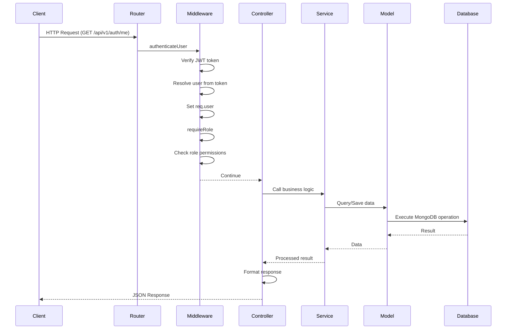

### Folder Structure

**Client/src/**
```
Client/src/
├── Animations/          # Motion animations
├── Components/          # Reusable UI components
│   ├── AuthRoute.jsx    # Protected route wrapper
│   ├── ProtectedRoute.jsx
│   ├── Common/          # Button, Card, Input, Modal, Select, Toast
│   ├── Landing/         # Landing page components
│   ├── Loader/          # Loading components
│   ├── Navigations/     # Navbar and Sidebar per role
│   └── SPOC/            # SPOC-specific components
├── Layout/              # Layout wrappers per role
├── Pages/               # Route pages
│   ├── Auth/            # Login/Signup pages
│   ├── Services/
│   │   ├── Admin/       # Admin pages
│   │   ├── DeptTPO/     # TPO pages
│   │   ├── SPOC/        # SPOC pages
│   │   └── Students/    # Student pages
│   ├── Landing/         # Landing page
│   ├── Contact/         # Contact page
│   └── Not Found/       # 404 page
├── Services/            # API service layer
│   ├── Queries/         # React Query hooks
│   └── authSlice.js     # Redux auth slice
├── Hooks/               # Custom React hooks
├── App.jsx              # App router wrapper
└── main.jsx             # Entry point
```

**Server/**
```
Server/
├── config/              # Configuration files
│   ├── auth.config.js   # Auth configuration
│   ├── notification.config.js
│   ├── cookieConfig.config.js
│   ├── db.config.js     # MongoDB connection
│   └── httpConfig.config.js
├── middlewares/         # Express middleware
│   ├── auth.middleware.js
│   ├── role.middleware.js
│   ├── error.middleware.js
│   └── documentUpload.middleware.js
├── models/              # Mongoose schemas
│   ├── students.models.js
│   ├── tpo.models.js
│   ├── spoc.models.js
│   ├── organisation.models.js
│   ├── studentApplication.models.js
│   ├── studentDocument.models.js
│   ├── noc.models.js
│   ├── notification.models.js
│   └── refreshSessions.models.js
├── routes/              # Express routes
│   ├── auth.routes.js
│   ├── studentApplication.routes.js
│   ├── spocApplication.routes.js
│   ├── tpoApplication.routes.js
│   └── organisation.routes.js
├── services/            # Business logic
│   ├── auth/            # Authentication services
│   ├── students/        # Student services
│   ├── tpo/             # TPO services
│   ├── spoc/            # SPOC services
│   ├── notification/    # Notification service
│   └── noc/             # NOC generation service
├── utils/               # Utility functions
│   ├── helper.utils.js
│   ├── nocStorage.utils.js
│   └── Mail/mail.utils.js
├── index.js             # Entry point
└── app.js               # Express app setup
```

---

## 8. Data Model

### ER Diagram

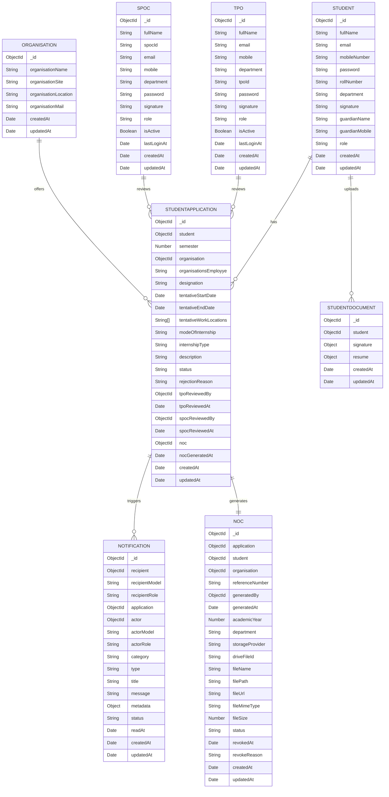

### Model Descriptions

| Model | Fields | Relationships |
|-------|--------|---------------|
| **Student** | _id, fullName, email, mobileNumber, password, rollNumber, department, signature, guardianName, guardianMobile, role | Has many StudentApplications, Has one StudentDocument |
| **TPO** | _id, fullName, email, mobile, department, tpoId, password, signature, role, isActive, lastLoginAt | Reviews many StudentApplications (via tpoReviewedBy) |
| **SPOC** | _id, fullName, spocId, email, mobile, department, password, signature, role, isActive, lastLoginAt | Reviews many StudentApplications (via spocReviewedBy) |
| **Organisation** | _id, organisationName, organisationSite, organisationLocation, organisationMail | Many-to-many with StudentApplications |
| **StudentApplication** | _id, student, semester, organisation, organisationsEmployye, designation, tentativeStartDate, tentativeEndDate, tentativeWorkLocations, modeOfInternship, internshipType, description, status, rejectionReason, rejectedBy, tpoReviewedBy, tpoReviewedAt, spocReviewedBy, spocReviewedAt, noc, nocGeneratedAt | Belongs to Student, Organisation; Has one NOC |
| **StudentDocument** | _id, student, signature, resume | Belongs to one Student |
| **Notification** | _id, recipient, recipientModel, recipientRole, application, actor, actorModel, actorRole, category, type, title, message, metadata, status, readAt | Belongs to Application |
| **NOC** | _id, application, student, organisation, referenceNumber, generatedBy, generatedAt, academicYear, department, storageProvider, driveFileId, fileName, filePath, fileUrl, fileMimeType, fileSize, status, revokedAt | Belongs to Application, Student, Organisation |
| **RefreshSession** | _id, user, userModel, tokenHash, previousTokenHash, familyId, expiresAt, revokedAt | Tracks refresh token sessions |

---

## 9. API Documentation

### Authentication API (`/api/v1/auth`)

| Method | Endpoint | Role | Request | Response | Errors |
|--------|----------|------|---------|----------|--------|
| POST | `/students/register` | Public | `fullName, email, mobileNumber, password, rollNumber, department, guardianName, guardianMobile, signature` (multipart) | `{ student, accessToken }` | 400 Invalid input, 409 Duplicate email/rollNumber, 415 Invalid signature format |
| POST | `/students/login` | Public | `{ email, password }` | `{ student, accessToken }` + HttpOnly cookie | 401 Invalid credentials, 404 User not found |
| POST | `/tpo/register` | Public | `{ fullName, email, mobile, department, tpoId, password }` | `{ tpo }` | 400 Invalid TPO ID, 409 Duplicate email |
| POST | `/tpo/login` | Public | `{ email, password }` | `{ tpo, accessToken }` + HttpOnly cookie | 401 Invalid credentials, 403 Account inactive |
| POST | `/spoc/register` | Public | `{ fullName, spocId, email, mobile, department, password }` | `{ spoc }` | 409 Duplicate email/spocId |
| POST | `/spoc/login` | Public | `{ email, password }` | `{ spoc, accessToken }` + HttpOnly cookie | 401 Invalid credentials |
| POST | `/refresh-token` | Public | - (refresh cookie) | `{ accessToken, userModel }` + new cookie | 401 Invalid/revoked token |
| GET | `/me` | Authenticated | - | Current user object | 401 Not authenticated |
| POST | `/logout` | Authenticated | - | Success message | - |

### Student Application API (`/api/v1/application`)

| Method | Endpoint | Role | Request | Response | Errors |
|--------|----------|------|---------|----------|--------|
| POST | `/students/apply` | student | `semester, organisation, organisationsEmployye, designation, tentativeStartDate, tentativeEndDate, tentativeWorkLocations, modeOfInternship, internshipType, description` | Created application | 400 Invalid data, 404 Organisation not found |
| GET | `/students/getapplications` | student | - | Array of applications | - |
| PATCH | `/:applicationId/resubmit` | student | `{ updateRequiredReason }` | Updated application | 403 Not owner, 409 Wrong status |

### TPO Application API (`/api/v1/applications`)

| Method | Endpoint | Role | Request | Response | Errors |
|--------|----------|------|---------|----------|--------|
| GET | `/tpo` | TPO | `status?, search?` | Department applications | 403 Not in department |
| GET | `/tpo/:applicationId` | TPO | - | Application details | 403 Not in department, 404 Not found |
| POST | `/tpo/:applicationId/accept` | TPO | - | Approved application | 400 Wrong status |
| POST | `/tpo/:applicationId/send-back` | TPO | `{ reason }` | Application with update_required | 400 Wrong status, 409 No reason |

### SPOC Application API (`/api/v1/applications`)

| Method | Endpoint | Role | Request | Response | Errors |
|--------|----------|------|---------|----------|--------|
| GET | `/spoc` | SPOC | - | Applications approved by TPO | - |
| GET | `/spoc/nocs` | SPOC | - | Generated NOCs | - |
| POST | `/spoc/noc/bulk` | SPOC | `{ applicationIds[] }` | `{ groups[], skipped[] }` | 400 No applications, 409 Already generated |
| GET | `/spoc/organisation/:organisationId` | SPOC | - | Applications by organisation | - |
| GET | `/spoc/:applicationId` | SPOC | - | Application details | - |
| POST | `/spoc/:applicationId/accept` | SPOC | - | Approved application | 400 Wrong status |
| POST | `/spoc/:applicationId/reject` | SPOC | `{ reason }` | Rejected application | 400 Wrong status |
| POST | `/spoc/:applicationId/send-back` | SPOC | `{ reason }` | Application with update_required | 400 Wrong status |
| POST | `/spoc/:applicationId/noc` | SPOC | - | Generated NOC | 400 Status not approved |
| POST | `/spoc/:applicationId/noc/regenerate` | SPOC | - | Regenerated NOC | 404 NOC not found |
| GET | `/spoc/:applicationId/noc` | SPOC | - | NOC details | - |
| GET | `/spoc/:applicationId/noc/pdf` | SPOC | - | PDF file download | 404 NOC not found |
| GET | `/spoc/:applicationId/reviews` | SPOC | - | Review history | - |

### Student Dashboard API (`/api/v1/dashboard`)

| Method | Endpoint | Role | Request | Response | Errors |
|--------|----------|------|---------|----------|--------|
| GET | `/students` | student | - | Dashboard stats and summary | - |

### Student Documents API (`/api/v1/student/documents`)

| Method | Endpoint | Role | Request | Response | Errors |
|--------|----------|------|---------|----------|--------|
| GET | `/` | student | - | Student documents | - |
| PUT | `/signature` | student | `signature` (multipart) | Updated signature URL | 400 Invalid file |
| PUT | `/resume` | student | `resume` (multipart) | Updated resume URL | 400 Invalid file |
| GET | `/noc` | student | - | Student's NOC | - |

### Student Notifications API (`/api/v1/student/notifications`)

| Method | Endpoint | Role | Request | Response | Errors |
|--------|----------|------|---------|----------|--------|
| GET | `/` | student | `status?, search?, limit?` | Notifications array | - |
| GET | `/unread-count` | student | - | Unread count | - |
| PATCH | `/:notificationId/read` | student | - | Marked notification | - |
| PATCH | `/read-all` | student | - | All marked read | - |
| DELETE | `/:notificationId` | student | - | Deleted notification | - |

### Organisation API (`/api/v1/organisation`)

| Method | Endpoint | Role | Request | Response | Errors |
|--------|----------|------|---------|----------|--------|
| GET | `/` | Public | - | List of organisations | - |
| GET | `/:organisationId` | Public | - | Organisation details | 404 Not found |
| POST | `/` | Admin | `{ organisationName, organisationSite, organisationLocation, organisationMail }` | Created organisation | 409 Duplicate |

### TPO Dashboard API (`/api/v1/tpo/dashboard`)

| Method | Endpoint | Role | Request | Response | Errors |
|--------|----------|------|---------|----------|--------|
| GET | `/` | TPO | - | Dashboard stats, charts data | - |

---

## 10. Authentication and Authorization

### Login Flow by Role

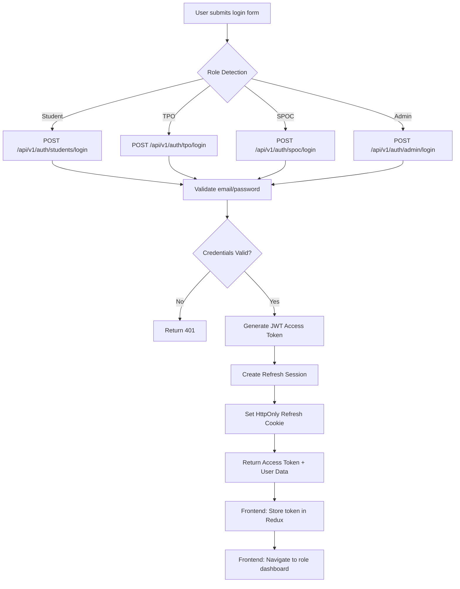

### Token Configuration

| Setting | Value | Description |
|---------|-------|-------------|
| **Access Token Secret** | `ACCESS_TOKEN_SECRET` env | JWT signing secret |
| **Access Token Expiry** | `ACCESS_TOKEN_EXPIRY` env | Token lifetime (e.g., 15m) |
| **Refresh Token Expiry** | Configured in session | Longer lifetime (e.g., 7d) |
| **Cookie Name** | `refresh:<userModel>` | Dynamic per role (Student, TPO, SPOC, Admin) |
| **SameSite** | `Lax` | CSRF protection |
| **Secure** | `true` in production | HTTPS only |

### Session Management

| Feature | Description |
|---------|-------------|
| **Refresh Session Rotation** | Each refresh token usage generates a new one and revokes the old |
| **Family ID** | All refresh tokens from same browser/device share a familyId |
| **Revocation** | Logout revokes current session; login revokes all previous sessions |
| **Expiration** | Sessions auto-expire after configured duration (TTL on MongoDB index) |

### Route Protection

```javascript
// Frontend: ProtectedRoute.jsx
<Route
  path="/dashboard"
  element={
    <ProtectedRoute allowedRoles={['student', 'tpo', 'spoc']}>
      <Dashboard />
    </ProtectedRoute>
  }
/>

// Backend: middleware/role.middleware.js
spocApplicationRoutes
  .get('/spoc', requireRole('spoc'), getSpocApplicationsController)
```

### Password Reset (Not Implemented)

**Planned Flow:**
1. User requests reset → receives email with token
2. User clicks link → navigates to reset page
3. User sets new password → token expires

---

## 11. Third-Party Integrations

### Cloudinary

| Function | Description |
|----------|-------------|
| **Signature Upload** | Student signatures uploaded to `jgec-internship/students/signatures/` with `removeSignatureBackground: true` |
| **Resume Upload** | Student resumes stored in Cloudinary (pending implementation) |
| **Image Processing** | Automatic background removal, format conversion to WebP |

### Google Drive

| Function | Description |
|----------|-------------|
| **NOC Storage** | Generated NOC PDFs stored in Google Drive |
| **OAuth2 Flow** | Service account authentication with `googleapis` package |
| **File ID Reference** | NOC records store `driveFileId` instead of local path |
| **File Naming** | Format: `NOC-<referenceNumber>.pdf` |

### Mail Service (Nodemailer)

| Function | Description |
|----------|-------------|
| **SMTP Configuration** | `SMTP_HOST`, `SMTP_PORT`, `SMTP_USER`, `SMTP_PASS`, `MAIL_FROM` |
| **Concurrency** | 5 emails concurrently via `sendBulkMail` |
| **NOC Email** | Sends with PDF attachment, HTML/text templates |
| **Notification Emails** | Status change notifications (no attachment) |

### PDF Generation (PDFKit)

| Function | Description |
|----------|-------------|
| **Template** | `Server/template/noc.template.js` |
| **Content** | Student details, organisation details, internship dates, signatories (TPO + SPOC) |
| **Format** | A4 PDF with college header, signature lines |

---

## 12. Notifications System

### Notification Catalogue

| Event Type | Category | Recipient | Message |
|------------|----------|-----------|---------|
| `application_submitted` | application | TPO (all active) | "New application submitted for your review" |
| `application_forwarded` | verification | SPOC (student's department) | "Application awaiting your review" |
| `tpo_accepted` | application | Student | "Your application accepted by TPO" |
| `tpo_rejected` | application | Student | "Your application rejected by TPO" |
| `tpo_update_required` | application | Student | "TPO requested changes to your application" |
| `spoc_accepted` | verification | Student | "Your application accepted by SPOC" |
| `spoc_rejected` | verification | Student | "Your application rejected by SPOC" |
| `spoc_update_required` | verification | Student | "SPOC requested changes to your application" |
| `noc_generated` | document | Student | "Your NOC generated (Ref: XXX)" |
| `noc_batch_generated` | document | SPOC (generating) | "NOC generated for N student(s)" |

### Notification Endpoints

| Method | Endpoint | Role | Action |
|--------|----------|------|--------|
| GET | `/api/v1/student/notifications` | student | List notifications |
| GET | `/api/v1/student/notifications/unread-count` | student | Get unread count |
| PATCH | `/api/v1/student/notifications/:id/read` | student | Mark as read |
| PATCH | `/api/v1/student/notifications/read-all` | student | Mark all as read |
| DELETE | `/api/v1/student/notifications/:id` | student | Delete notification |

### Email Templates

**NOC Email Subject:** `No Objection Certificate - {organisation} ({referenceNumber})`

**NOC Email Body (HTML):**
```
Dear {studentName},
Your No Objection Certificate for the internship at {organisation} 
has been generated. Reference No: {referenceNumber}.
The certificate is attached to this email.
```

---

## 13. NOC Generation

### Reference Number Format

```
TNP/JGEC/INT/<year>/<department>/<sequence>

Example: TNP/JGEC/INT/2026/CSE/001
```

### NOC Generation Logic

| Step | Description |
|------|-------------|
| 1 | Validate application status = "approved_by_spoc" |
| 2 | Find student's department |
| 3 | Generate unique reference number (MongoDB transaction) |
| 4 | Build NOC PDF with all details |
| 5 | Upload PDF to Google Drive |
| 6 | Create NOC record in database |
| 7 | Update application status to "noc_generated" |
| 8 | Publish notification to student |
| 9 | Send email with attachment |

### Bulk NOC Generation

| Grouping | Reference Number |
|----------|------------------|
| Same organisation + same department | Single reference for all students |
| Different organisation or department | Separate reference numbers |

**Example:**
```
Applications: A-CSE (org X), B-CSE (org X), C-IT (org X)
Groups:
  - CSE + org X → TNP/JGEC/INT/2026/CSE/001
  - IT + org X → TNP/JGEC/INT/2026/IT/001
```

### NOC Status Values

| Status | Description |
|--------|-------------|
| `generated` | NOC created and available |
| `revoked` | NOC invalidated by admin/SPOC |

---

## 14. Security and Compliance

### Input Validation

| Layer | Validation |
|-------|------------|
| **Email** | Regex pattern, college domain whitelist |
| **Mobile** | `^(?:\+91|91)?[6-9]\d{9}$` (Indian numbers) |
| **Password** | Min 6 chars, must contain upper, lower, digit, special char |
| **Roll Number** | Unique, trimmed, case-insensitive |
| **Signature** | 30-100 KB, image/jpeg/jpg/png/webp only |

### Security Headers

```javascript
app.use(helmet()); // Default security headers
app.disable("x-powered-by");
```

### CORS Configuration

| Setting | Value |
|---------|-------|
| `origin` | `CORS_ORIGIN` env variable |
| `credentials` | `true` (for cookies) |

### File Upload Restrictions

| Constraint | Value |
|------------|-------|
| Max size | 100 KB (multer limit) |
| Allowed types | image/jpeg, image/jpg, image/png, image/webp |

### Data Privacy

| Requirement | Status |
|-------------|--------|
| Password hashing | ✓ Bcrypt (12 rounds) |
| Email encryption | N/A (stored plain) |
| API rate limiting | Not yet implemented |
| Audit logging | Partial (application history in reviews) |

### Known Security Risks

| Risk | Mitigation |
|------|------------|
| XSS in PDF generation | ✓ HTML escaping in noc.template.js |
| CSRF | HttpOnly cookies + SameSite=Lax |
| Injection | ✓ Mongoose parameterized queries |
| Token theft | ✓ HttpOnly cookies, short access token expiry |

---

## 15. Testing Strategy

### Current Test Coverage

| Layer | Folder | Tests | Coverage |
|-------|--------|-------|----------|
| **Server Unit** | `Server/test/unit/` | `auth.unit.test.js` | Auth service logic |
| **Server Integration** | `Server/test/integration/` | `auth.integration.test.js` | API integration |
| **Server Regression** | `Server/test/regression/` | `auth.regression.test.js` | Auth regression |
| **Server Smoke** | `Server/test/smoke/` | `auth.smoke.test.js` | Auth smoke tests |
| **Server Mail** | `Server/test/` | `sendmail.test.js` | Email sending |
| **Client E2E** | `Client/tests/e2e/` | `auth.e2e.spec.js` | Auth with Playwright |

### Test Coverage Gaps

| Area | Missing Tests |
|------|---------------|
| Application submission workflow | No integration tests |
| NOC generation | No unit/integration tests |
| SPOC review workflow | No tests |
| TPO review workflow | No tests |
| Bulk NOC generation | No tests |
| Organisation CRUD | No tests |
| Student dashboard | No tests |

### Recommendations

1. **Add Application Tests:** Integration tests for full application workflow
2. **Add NOC Tests:** Unit tests for PDF generation, integration tests for NOC creation
3. **Add SPOC Tests:** Tests for application review, NOC generation flows
4. **Add E2E Tests:** Complete user journey tests with Playwright
5. **Add Performance Tests:** Response time benchmarks

---

## 16. DevOps and Setup

### Environment Variables

**Required (.env):**
```
NODE_ENV=development|production
PORT=5000

# MongoDB
MONGODB_URI=mongodb://localhost:27017/jgec_internship

# JWT
ACCESS_TOKEN_SECRET=<random-secret>
ACCESS_TOKEN_EXPIRY=15m
ACCESS_TOKEN_ISSUER=jgec
ACCESS_TOKEN_AUDIENCE=jgec-students

# Email (SMTP)
SMTP_HOST=smtp.gmail.com
SMTP_PORT=587
SMTP_USER=<email>
SMTP_PASS=<app-password>
MAIL_FROM=<email>

# College Email Domains
COLLEGE_MAILS=["@jgec.ac.in","@gmail.com"]

# Frontend
CORS_ORIGIN=http://localhost:5173

# Cloudinary
CLOUDINARY_CLOUD_NAME=<cloud-name>
CLOUDINARY_API_KEY=<api-key>
CLOUDINARY_API_SECRET=<api-secret>

# Google Drive
GOOGLE_CLIENT_ID=<client-id>
GOOGLE_CLIENT_SECRET=<client-secret>
GOOGLE_REFRESH_TOKEN=<refresh-token>

# TPO ID (for registration)
TPO_ID=TPO2024
```

### Installation Steps

```bash
# Backend
cd Server
npm install
npm run dev  # or node index.js

# Frontend (in separate terminal)
cd Client
npm install
npm run dev
```

### Deployment Recommendations

| Component | Recommendation |
|-----------|----------------|
| **Hosting** | Render, Railway, or AWS EC2 |
| **Database** | MongoDB Atlas (production) |
| **Domain** | Custom domain with HTTPS |
| **Health Check** | `/api/v1/health` endpoint |
| **Logging** | PM2 + Winston logger |
| **Backups** | MongoDB Atlas automated backups |

### Health Check Endpoint

**Status:** Not yet implemented (placeholder in `Server/services/health/`)

**Planned Response:**
```json
{
  "statusCode": 200,
  "status": "healthy",
  "database": "connected",
  "timestamp": "2026-11-05T17:00:00Z"
}
```

---

## 17. Analytics and Reporting

### TPO Dashboard Charts

| Chart | Data |
|-------|------|
| Application Status Distribution | Pie chart by status |
| Application Trend (Monthly) | Line chart over time |
| Department Progress | Bar chart by semester |

### Admin Dashboard Stats

| Metric | Description |
|--------|-------------|
| Total Students | Count of all registered students |
| Total Organisations | Count of organisations |
| Active Applications | Count of submitted/approved applications |
| NOCs Generated | Count of generated NOCs |

### Export Features

| Export Type | Format | Endpoint |
|-------------|--------|----------|
| TPO Application Report | CSV/Excel | `GET /api/v1/tpo/dashboard/export` |
| Student List | CSV/Excel | Admin student management |
| NOC Report | PDF | Admin/SP OC dashboard |

---

## 18. Risks, Limitations and Technical Debt

### Identified Issues

| Issue | Location | Impact |
|-------|----------|--------|
| **Double extension** | `SPOCDashboard.jsx.jsx` | Potential import issues |
| **Empty admin folder** | `Server/services/admin/` | Admin module not implemented |
| **Empty health files** | `Server/services/health/` | No health check endpoint |
| **Empty NOC folder** | `Client/src/Pages/Services/SPOC/NOC/` | SPOC NOC page incomplete |
| **Empty company files** | `Client/src/Pages/Services/Admin/Companies/` | Admin company CRUD not implemented |
| **Reject mutation unavailable** | `SPOCDashboard.jsx.jsx:297` | SPOC cannot reject applications |

### Technical Debt

| Debt | Priority | Description |
|------|----------|-------------|
| Rate limiting | Medium | Not implemented for login/registration |
| Email verification | Medium | TPO registration doesn't verify email |
| Audit logs | Low | Limited tracking of admin actions |
| Caching | Low | No Redis caching for frequent queries |
| Error monitoring | Low | No Sentry or similar integration |

### Code Quality Issues

| Issue | Severity |
|-------|----------|
| Missing null checks | Medium |
| Error handling inconsistency | Medium |
| Missing TypeScript | Low (plan to migrate) |
| Inconsistent naming | Low |

---

## 19. Roadmap

### Short-term (1-2 months)

| Priority | Task |
|----------|------|
| 1 | Fix double extension filename (`SPOCDashboard.jsx.jsx`) |
| 2 | Complete admin module (organisations CRUD) |
| 3 | Implement health check endpoint |
| 4 | Add rate limiting for auth endpoints |
| 5 | Complete SPOC NOC page components |

### Mid-term (3-6 months)

| Priority | Task |
|----------|------|
| 1 | Add TPO reject endpoint (currently missing) |
| 2 | Implement email verification for TPO registration |
| 3 | Add application analytics charts |
| 4 | Implement CSV/Excel export functionality |
| 5 | Add file upload for student resume |

### Long-term (6-12 months)

| Priority | Task |
|----------|------|
| 1 | Migrate to TypeScript |
| 2 | Add audit logging for admin actions |
| 3 | Implement Redis caching |
| 4 | Add Sentry error monitoring |
| 5 | Mobile-responsive enhancements |
| 6 | Multi-institution support |

---

## 20. Glossary and Appendices

### Terms

| Term | Definition |
|------|------------|
| **SPOC** | Single Point of Contact - Organisation liaison who reviews student applications |
| **TPO** | Training and Placement Officer - Department officer who approves student applications |
| **NOC** | No Objection Certificate - Official college permission letter for internship |
| **Student** | Enrolled student seeking internship |
| **Admin** | System administrator with oversight capabilities |

### File Tree Explanation

| Path | Purpose |
|------|---------|
| `Client/src/Pages/Auth/` | Login and signup pages for each role |
| `Client/src/Pages/Services/Student/` | Student-facing pages |
| `Client/src/Pages/Services/SPOC/` | SPOC-facing pages |
| `Client/src/Pages/Services/DeptTPO/` | TPO-facing pages |
| `Client/src/Pages/Services/Admin/` | Admin-facing pages |
| `Server/routes/` | Express route definitions |
| `Server/services/` | Business logic and controllers |
| `Server/models/` | Mongoose schema definitions |
| `Server/config/` | Application configuration |

### Academic Years

Academic year is calculated from the current year when NOC is generated.

**Example:** NOC generated on `2026-03-15` → Academic Year = `2026`

---

*END OF PRD*
