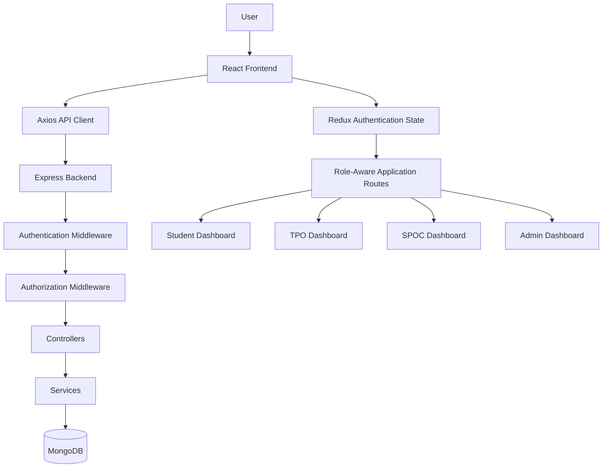
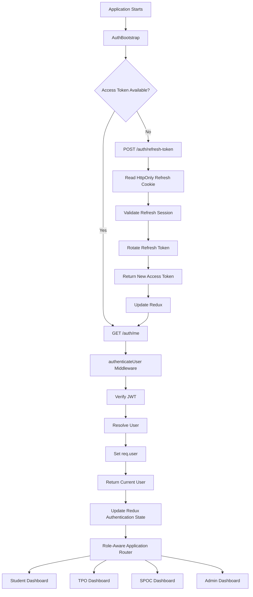
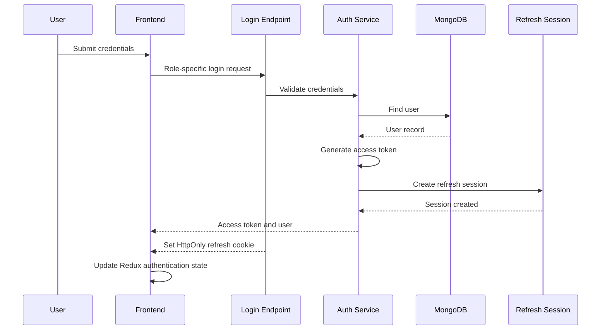
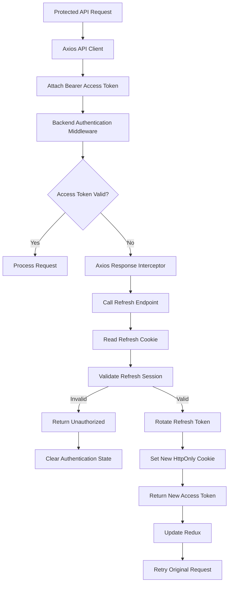
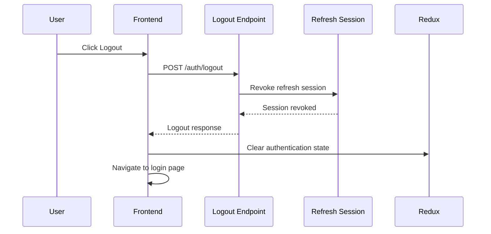
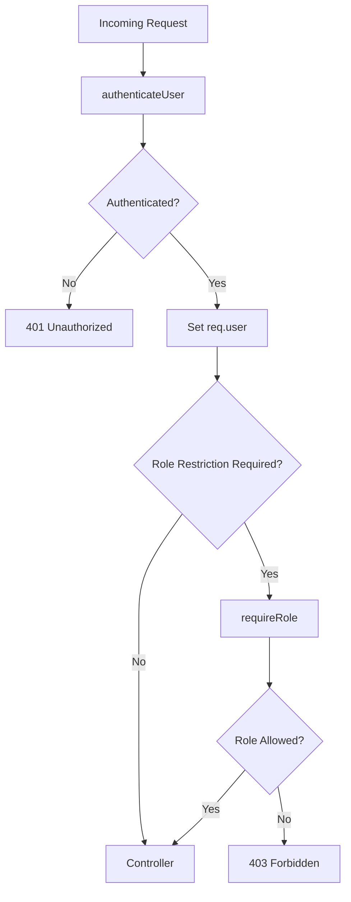

# JGEC Internship Management Portal

A centralized web-based platform for managing internship-related workflows at Jalpaiguri Government Engineering College (JGEC). The application supports role-based access for Students, Training and Placement Officers (TPOs), Single Point of Contact (SPOCs), and Administrators.

---

## Table of Contents

- [Overview](#overview)
- [Features](#features)
- [User Roles](#user-roles)
- [Technology Stack](#technology-stack)
- [System Architecture](#system-architecture)
- [Authentication Architecture](#authentication-architecture)
- [Project Structure](#project-structure)
- [Prerequisites](#prerequisites)
- [Installation and Setup](#installation-and-setup)
- [Environment Variables](#environment-variables)
- [Authentication API](#authentication-api)
- [Authentication and Authorization](#authentication-and-authorization)
- [Security](#security)
- [Development Workflow](#development-workflow)
- [Testing](#testing)
- [Deployment](#deployment)
- [Troubleshooting](#troubleshooting)
- [Contributing](#contributing)
- [License](#license)

---

## Overview

The JGEC Internship Management Portal is designed to centralize internship-related activities through a role-based web application.

The application separates authentication from authorization and uses a centralized authentication architecture to manage authenticated users consistently across the frontend and backend.

The authentication architecture includes:

- Role-specific login and registration endpoints.
- Centralized current-user resolution.
- JWT-based access-token authentication.
- Refresh-token rotation and refresh-session management.
- HttpOnly refresh cookies.
- Centralized logout and session revocation.
- Redux-based frontend authentication state.
- Axios interceptors for access-token refresh and request retry.
- Backend role-based authorization middleware.

### Project Repository

[GitHub Repository](https://github.com/Subhas6033/JGEC-Internship-Management/)

### Authentication Workflow

The detailed centralized authentication design is documented in:

`JGEC-Centralized-Authentication-Diagram(1).md`

---

## Features

### Authentication

- Role-specific authentication endpoints.
- JWT access-token generation and verification.
- Refresh-session creation and validation.
- Refresh-token rotation.
- HttpOnly refresh cookies.
- Centralized logout and refresh-session revocation.
- Current-user retrieval through a shared endpoint.
- Authentication restoration during application startup.
- Automatic access-token refresh and retry of protected API requests.

### Authorization

- Role-aware frontend routing.
- Centralized authenticated-user identity through `req.user`.
- Backend authentication middleware.
- Role-restricted routes through `requireRole(...)`.
- Separation of authentication and authorization responsibilities.

### Frontend

- React-based application architecture.
- Redux-managed authentication state.
- Axios-based API communication.
- Centralized API request and response handling.
- Authentication bootstrap during application initialization.

### User Areas

- Student dashboard.
- Department TPO dashboard.
- SPOC dashboard.
- Admin dashboard.

The exact functionality available in each dashboard depends on the current implementation.

---

## User Roles

| Role    | Responsibility                                                                   |
| ------- | -------------------------------------------------------------------------------- |
| Student | Access student-facing internship workflows and the student dashboard.            |
| TPO     | Access authorized department-level Training and Placement Officer functionality. |
| SPOC    | Access authorized SPOC workflows and the SPOC dashboard.                         |
| Admin   | Access administrative functionality and the admin dashboard.                     |

The backend is responsible for enforcing permissions. Frontend navigation alone must never be treated as an authorization mechanism.

---

## Technology Stack

The project's documented architecture uses the following technologies.

| Layer                  | Technology                            |
| ---------------------- | ------------------------------------- |
| Frontend               | React                                 |
| State Management       | Redux                                 |
| HTTP Client            | Axios                                 |
| Backend Runtime        | Node.js                               |
| Backend Framework      | Express.js                            |
| Database               | MongoDB                               |
| Object Document Mapper | Mongoose                              |
| Authentication         | JSON Web Tokens (JWT)                 |
| Session Management     | Refresh sessions and HttpOnly cookies |
| API Architecture       | REST-style HTTP endpoints             |

Additional UI libraries and development dependencies should be verified against the actual `package.json` files.

---

## System Architecture

The application follows a client-server architecture.



---

## Authentication Architecture

The application keeps login and registration role-specific while centralizing the common authentication lifecycle.

### Central Authentication Flow



### Role-Specific Login Endpoints

```text
POST /auth/students/login
POST /auth/tpo/login
POST /auth/spoc/login
POST /auth/admin/login
```

### Role-Specific Registration Endpoints

```text
POST /auth/students/register
POST /auth/tpo/register
POST /auth/spoc/register
POST /auth/admin/register
```

### Centralized Authentication Endpoints

```text
GET  /auth/me
POST /auth/refresh-token
POST /auth/logout
```

Verify the actual route definitions and API mounting prefix in the source code before integrating with these endpoints.

### Login Flow



### Access-Token Refresh Flow



The documented frontend architecture uses a shared `refreshPromise` to deduplicate concurrent refresh attempts and a browser lock where supported.

### Logout Flow



### Authentication State

The documented Redux authentication state has the following general structure:

```javascript
{
  user: null,
  accessToken: null,
  status: "idle",
  isAuthenticated: false
}
```

After successful authentication, it may resemble:

```javascript
{
  user: {
    _id: "...",
    fullName: "...",
    email: "...",
    role: "TPO"
  },
  accessToken: "...",
  status: "authenticated",
  isAuthenticated: true
}
```

These are illustrative structures. The actual field names and state transitions should match the Redux slice implemented in the repository.

---

## Project Structure

The expected high-level layout separates frontend and backend code.

```text
JGEC-Internship-Management/
|
|-- Client/
|   |-- package.json
|   |-- src/
|       |-- Components/
|       |-- ...
|
|-- Server/
|   |-- package.json
|   |-- middlewares/
|   |-- ...
|
|-- README.md
```

This is a simplified illustration, not a verified inventory of every directory. Update it to match the actual repository structure.

### Frontend Responsibilities

- Render application pages and dashboards.
- Maintain client-side authentication state.
- Communicate with backend APIs.
- Attach access tokens to protected requests.
- Handle access-token refresh and request retry.
- Navigate users according to their roles.

### Backend Responsibilities

- Validate login and registration requests.
- Generate and verify JWT access tokens.
- Manage refresh sessions.
- Resolve the authenticated user.
- Enforce role-based authorization.
- Process business logic through controllers and services.
- Interact with MongoDB.

---

## Prerequisites

Before running the application, install:

- Node.js, using a version supported by the project.
- npm or the package manager specified by the repository.
- MongoDB or access to a compatible MongoDB deployment.
- Git.

Verify the required Node.js version and available scripts in the project's package manifests.

---

## Installation and Setup

### 1. Clone the Repository

```bash
git clone https://github.com/Subhas6033/JGEC-Internship-Management.git

cd JGEC-Internship-Management
```

### 2. Install Backend Dependencies

```bash
cd Server

npm install
```

If the backend directory has a committed `package-lock.json`, use `npm ci` for reproducible installation in CI or deployment environments.

### 3. Configure Backend Environment Variables

Create a local environment file using the actual variable names expected by the backend configuration.

See [Environment Variables](#environment-variables).

### 4. Start the Backend

Inspect the backend scripts:

```bash
npm run
```

If the project defines a `dev` script, start it using:

```bash
npm run dev
```

Otherwise, use the actual development or production script defined in `Server/package.json`.

### 5. Install Frontend Dependencies

Open a separate terminal:

```bash
cd Client

npm install
```

### 6. Configure the Frontend API URL

Set the frontend API base URL using the variable name expected by the client configuration.

Ensure that the configured URL points to the running backend.

### 7. Start the Frontend

Inspect the available scripts:

```bash
npm run
```

If a `dev` script exists, start the application using:

```bash
npm run dev
```

The actual local URLs and ports depend on the configuration in the repository.

---

## Environment Variables

The exact environment-variable names must be confirmed from the backend and frontend source code.

Search for:

```javascript
process.env;
```

and:

```javascript
import.meta.env;
```

Also inspect configuration files, database connection modules, token utilities, and cookie configuration.

### Typical Configuration Categories

| Configuration                      | Purpose                               |
| ---------------------------------- | ------------------------------------- |
| MongoDB URI                        | Database connectivity                 |
| Access-token secret or signing key | Access-token signing and verification |
| Token expiry                       | Access-token lifetime                 |
| Refresh-session expiry             | Session lifetime                      |
| Server port                        | Backend listening port                |
| Client origin                      | CORS and cookie configuration         |
| Frontend API base URL              | Backend API connectivity              |
| Cookie security settings           | Secure refresh-cookie behavior        |

### Illustrative Backend Environment File

The following example is a template only. Use the actual names read by your code.

```dotenv
NODE_ENV=development
PORT=5000

MONGODB_URI=mongodb://127.0.0.1:27017/jgec_internship

ACCESS_TOKEN_SECRET=replace_with_a_long_random_secret

CLIENT_ORIGIN=http://localhost:5173
```

**Important:**

- Do not assume these example variable names match the current application.
- Never commit real secrets or credentials.
- Never expose backend secrets through frontend environment variables.
- Use unique, strong production secrets.
- Configure production cookie security for HTTPS.
- Keep local environment files out of version control.

---

## Authentication API

The following table documents the routes represented in the centralized authentication design.

| Method | Endpoint                  | Purpose                                                 |
| ------ | ------------------------- | ------------------------------------------------------- |
| POST   | `/auth/students/login`    | Student login                                           |
| POST   | `/auth/tpo/login`         | TPO login                                               |
| POST   | `/auth/spoc/login`        | SPOC login                                              |
| POST   | `/auth/admin/login`       | Admin login                                             |
| POST   | `/auth/students/register` | Student registration                                    |
| POST   | `/auth/tpo/register`      | TPO registration                                        |
| POST   | `/auth/spoc/register`     | SPOC registration                                       |
| POST   | `/auth/admin/register`    | Admin registration                                      |
| GET    | `/auth/me`                | Retrieve the current authenticated user                 |
| POST   | `/auth/refresh-token`     | Refresh access token and rotate the refresh session     |
| POST   | `/auth/logout`            | Revoke the refresh session and clear the refresh cookie |

The backend may mount these routes under an additional prefix, such as `/api`. Verify the route definitions and server mounting configuration before using them.

### Protected API Requests

Protected requests use the access token in the Bearer authorization header.

```http
Authorization: Bearer <access-token>
```

The backend authentication middleware verifies the token, resolves the authenticated user, and assigns that user to `req.user`.

Role-restricted endpoints additionally require the appropriate authorization middleware.

---

## Authentication and Authorization

Authentication and authorization are separate responsibilities.

### Authentication

Authentication verifies the identity of the requester.

The `authenticateUser` middleware is responsible for validating the access token and resolving the authenticated user.

### Authorization

Authorization determines whether the authenticated user is allowed to access a resource or perform an operation.

The `requireRole(...)` middleware is used for role-restricted routes.



Frontend route guards improve navigation and user experience, but backend authorization remains authoritative.

---

## Security

Security controls should be reviewed before deploying the application to production.

### Token Security

- Verify access-token signatures and expiration.
- Validate the required JWT claims.
- Reject missing, malformed, expired, or invalid tokens.
- Use strong, protected signing secrets or keys.
- Keep access tokens short-lived according to application requirements.
- Validate refresh sessions on the server.
- Rotate refresh tokens according to the implemented session design.
- Revoke refresh sessions during logout.
- Define and test behavior for expired, revoked, or reused refresh tokens.

### Cookie Security

- Use HttpOnly refresh cookies.
- Enable the Secure attribute in HTTPS production environments.
- Configure an appropriate SameSite policy.
- Scope cookies to the required domain and path.
- Review CSRF protection according to the cookie policy and deployment architecture.

### API Security

- Enforce authorization on the backend.
- Validate request bodies, query parameters, and path parameters.
- Apply rate limiting to login, registration, and refresh endpoints.
- Avoid exposing password hashes, tokens, and sensitive internal errors.
- Use safe database query patterns.
- Apply least-privilege database credentials.
- Configure CORS with explicit trusted origins.

### Operational Security

- Keep secrets out of Git.
- Do not log passwords, authorization headers, refresh cookies, or tokens.
- Keep dependencies patched.
- Run dependency and security audits.
- Configure production error handling and monitoring.
- Back up production data and test recovery procedures.

These are recommended security checks, not a guarantee that every control is already implemented.

---

## Development Workflow

Recommended workflow for contributing changes:

1. Create a branch for the feature or bug fix.
2. Follow the existing naming conventions and architecture.
3. Keep controllers, services, middleware, and frontend components appropriately separated.
4. Validate inputs at API boundaries.
5. Add or update tests for changed behavior.
6. Run the quality checks available in the package manifests.
7. Review authentication and authorization implications for protected functionality.
8. Update documentation when behavior, endpoints, configuration, or setup instructions change.

### Suggested Branch Names

```text
feat/application-tracking
feat/internship-management
fix/auth-refresh
fix/role-authorization
docs/update-readme
```

These are examples; follow the team's existing branch conventions.

---

## Testing

Check the scripts available in `Client/package.json` and `Server/package.json`.

Typical commands, if supported by the project, include:

```bash
npm test
npm run lint
npm run build
```

Do not assume these scripts exist without checking the corresponding package manifest.

### Recommended Authentication Test Cases

- Successful login for each supported role.
- Rejection of invalid credentials.
- Missing or invalid access token.
- Expired access token.
- Valid refresh session and token rotation.
- Expired or revoked refresh session.
- Logout and refresh-session revocation.
- Concurrent requests requiring token refresh.
- Failed refresh without infinite retry loops.
- Access to a protected route by an authenticated user.
- Denial of a route to an unauthorized role.
- Authentication restoration after a page reload.
- Disabled or otherwise unauthorized accounts.
- Correct cookie behavior in development and production.

---

## Deployment

Before deploying the portal:

- [ ] Confirm supported Node.js and package-manager versions.
- [ ] Install dependencies from lockfiles where available.
- [ ] Configure production environment variables.
- [ ] Store secrets in the hosting platform's secret manager.
- [ ] Provision MongoDB with appropriate access controls.
- [ ] Configure database backups and recovery.
- [ ] Set the correct frontend API base URL.
- [ ] Configure CORS for trusted frontend origins.
- [ ] Enable HTTPS and secure cookie settings.
- [ ] Verify token expiration and refresh-session behavior.
- [ ] Verify backend role authorization.
- [ ] Run tests and production builds.
- [ ] Configure health checks, logs, and error monitoring.
- [ ] Test login, session restoration, refresh, and logout after deployment.
- [ ] Document deployment and rollback procedures.

Do not deploy with development secrets or expose stack traces and internal error details to production clients.

---

## Troubleshooting

### 401 Unauthorized

Possible causes:

- Missing Bearer access token.
- Invalid or expired access token.
- Invalid token signing configuration.
- Refresh session missing, expired, or revoked.
- Authenticated account cannot be resolved or is not permitted to authenticate.

Check the client interceptor, token configuration, refresh endpoint, cookie settings, and backend authentication logs.

### 403 Forbidden

The request may be authenticated, but the user's role does not have permission to access the requested resource.

Check the backend `requireRole(...)` configuration and the authenticated user's role. Do not remove authorization checks simply to make the request succeed.

### Refresh Cookie Not Sent

Check:

- Whether the client sends credentials where required.
- Whether CORS permits the frontend origin and credentials.
- Whether cookie domain and path are correct.
- Whether SameSite settings match the deployment.
- Whether Secure cookies are being used over HTTPS.

Cross-site cookie deployments generally require HTTPS and appropriate cookie attributes.

### Frontend Cannot Reach the Backend

Check:

- Backend process and listening port.
- Frontend API base URL.
- CORS configuration.
- Environment-variable names.
- Browser network errors.
- Backend logs.

### MongoDB Connection Failure

Check:

- MongoDB URI.
- Database availability.
- Credentials and permissions.
- Network access and IP allow-list settings.
- Database server logs.

Never paste database credentials or authentication tokens into public issues or logs.

---

## Contributing

Contributions are welcome according to the project's development workflow.

1. Fork the repository or create an authorized feature branch.
2. Make a focused change.
3. Follow existing code conventions.
4. Add tests or verification steps where appropriate.
5. Run available lint, test, and build scripts.
6. Update documentation if the change affects setup, configuration, API behavior, or architecture.
7. Open a pull request with a clear summary, rationale, and testing details.

For frontend changes, include screenshots when useful. For API changes, document modified endpoints, request schemas, response schemas, and authorization requirements.

Never include credentials, private tokens, production data, or sensitive user information in commits, screenshots, or issue reports.

---

## License

The project's license has not been specified in this README.

Add the chosen license and the corresponding `LICENSE` file before distributing the project. Do not assume that the repository is open source without confirming its licensing terms.

---

## Project Links

- **Repository:** https://github.com/Subhas6033/JGEC-Internship-Management/
- **Authentication Architecture:** `JGEC-Centralized-Authentication-Diagram(1).md`

---

## Maintainers' Notes

Keep this README aligned with the implementation.

Before publishing a release, verify:

- Actual project directory structure.
- Supported Node.js version.
- Package-manager and lockfile requirements.
- Available development, test, lint, and build scripts.
- Exact environment-variable names.
- API route mounting prefixes.
- Authentication request and response schemas.
- Implemented features for each role.
- Production deployment requirements.

The architecture and endpoint descriptions in this README reflect the documented centralized authentication design. They should not be treated as verification that every described behavior or security control is implemented in the current codebase.
